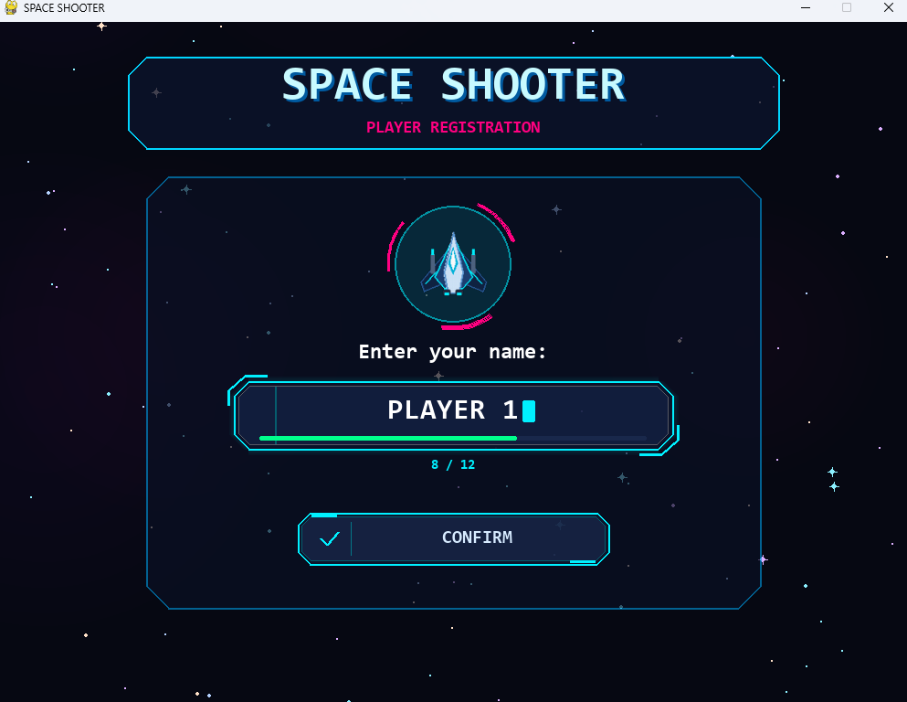
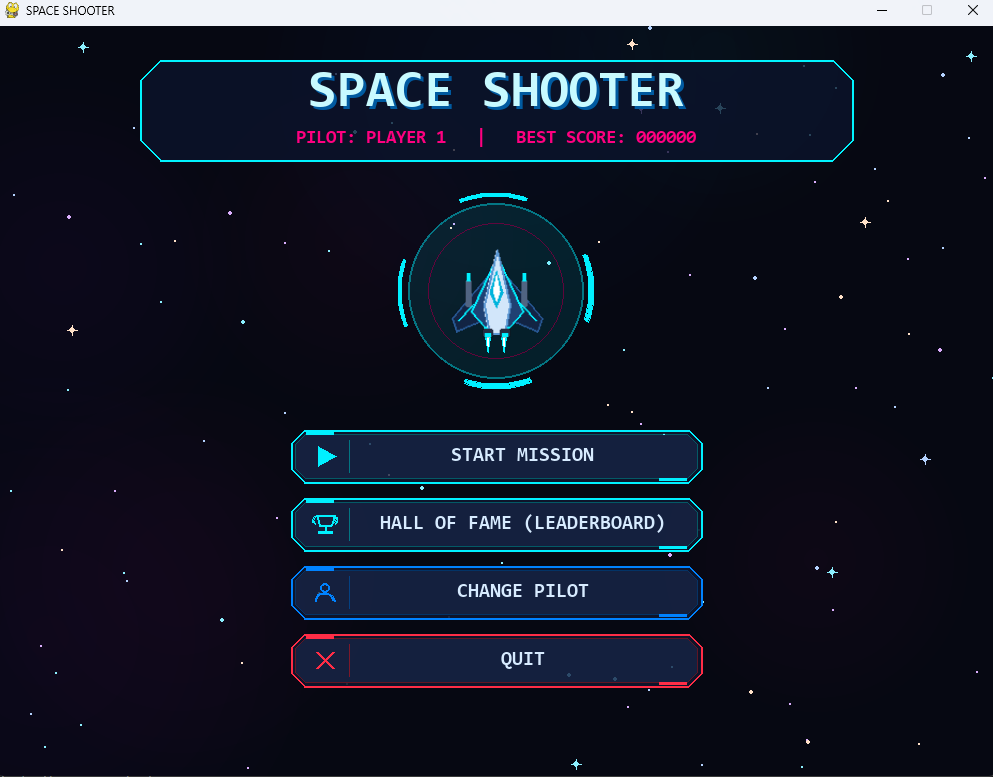
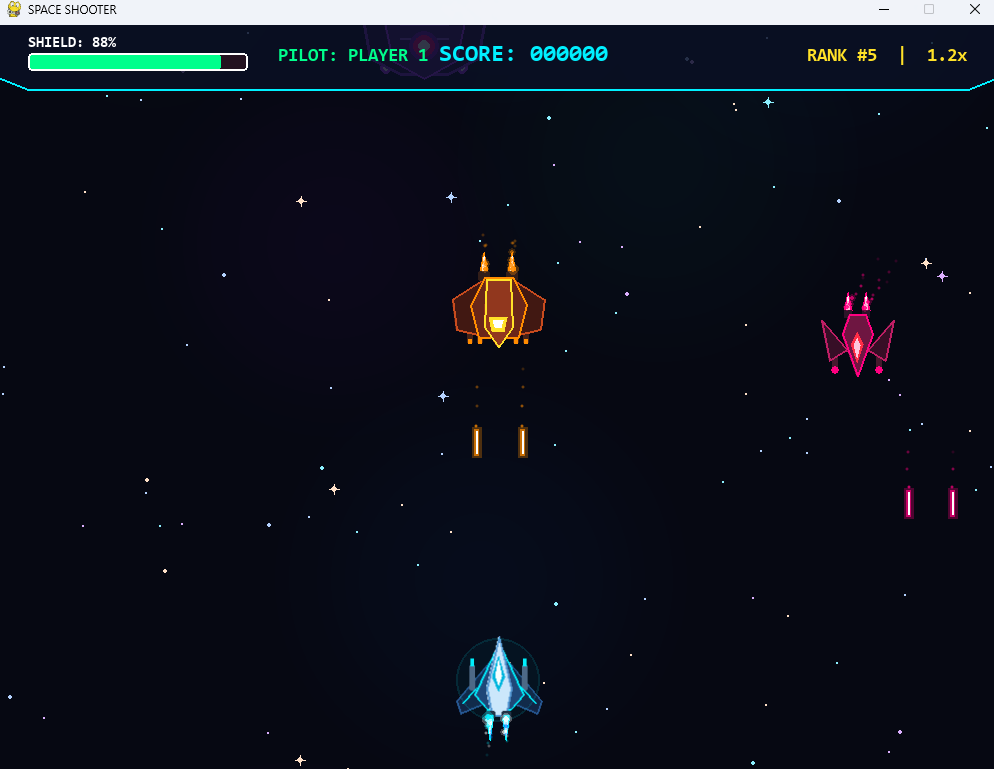
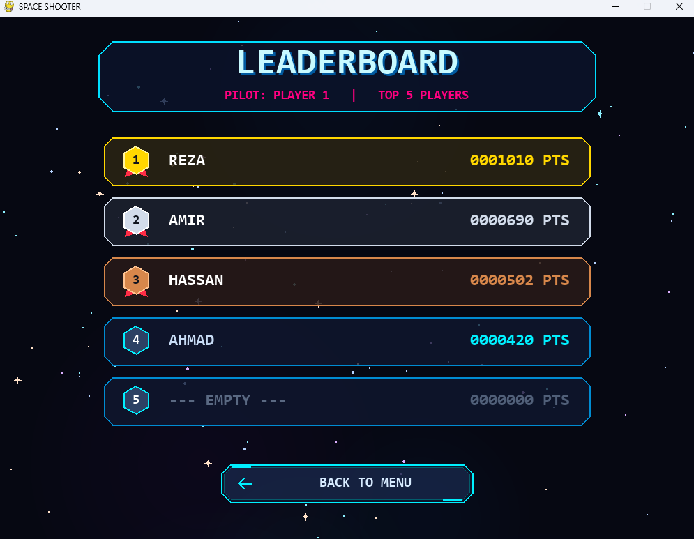

# Space Shooter

## Introduction

When you first open the game, the first screen you will see is the name screen where you write your pilot name and go to the main menu. In the main menu, you can start a new mission, look at the top scores in the leaderboard, change your current pilot name, or quit the game. Everything in the menu is easy to click with the mouse and shows a hologram preview of your spaceship in the middle of the screen.

After you press start, your ship is ready at the bottom. Move around with the arrow keys or WASD and press space to fire your lasers at the ships and rocks coming down. Hit an enemy enough times and it blows up for points, or let them pass the bottom of the window and they simply disappear without giving you any score.

Because the big purple ships shoot three balls at once, try to clear them out early before they crowd the screen. Continue this until you can't dodge anymore, and don't let the fast rocks disturb your flow because the waves do not stop while you are in the middle of playing. Keep your shield above zero and you keep getting a higher rank, but if the shield reach zero after taking too many hits, the game will end.

I also made various graphics as I was not going to make a simple one with plain blocks. They are all built with Pygame polygons, and you might notice that as you play the stars and space clouds in the background are actually moving at different speeds. In my opinion it gives the game a more lively feel, and having the leaderboard save your scores adds more fun too.

## Structure

Everything is compartmentalized into a single Python file named `space_shooter.py`, and the game creates `leaderboard.json` by itself when it need to save a result. Most of the graphics are created inside the Python code using Pygame, which means you don't need to download separate ship pictures or sound files before playing. Keeping the whole game in one file makes it very easy to open and run from the terminal on any computer.

I used separate classes in my code because combining almost 950 lines into one colossal function would just be a mess. Everything is compartmentalized into eleven classes like `SpriteFactory` for ship shapes, `Player` for flying, `EnemyShip` and `Asteroid` for targets, and `Starfield` for the four star layers. Even the menu buttons and the name input box are split into `Button` and `TextInputBox` so the UI code stays out of the way.

Instead of splitting the code across a dozen small files, all classes live inside `space_shooter.py` in a clean top-to-bottom order. The main `Game` class is tied into all other classes and switches between the name screen, main menu, playing screen, leaderboard, and game over screen. All of these classes get called from `Game.run()` during each frame so movement, collisions, particles, and HUD updates happen together.

## Game Features

The game has many aspects. Some make the game better in terms of performance and some just make them prettier.

- **Three enemy ships:** Interceptor, Gunship and Dreadnought.
- **Space rocks:** Asteroids come in 3 different sizes and split apart.
- **Player name:** You can key in your name before you start.
- **Change pilot:** You can switch your name in the menu without closing the window.
- **Shield bar:** There is a 100% shield limit before you lose.
- **Score:** You get points whenever you blow up a ship or asteroid.
- **Difficulty scaling:** The longer you play without dying, the faster and tougher the enemies get.
- **Live rank:** Check your current rank at the top while playing.

## How to Play

First you need to enter your name. After that the main menu will open. You can check your best score at the top and press the start mission button.

Now your ship is ready at the bottom. Move around with the arrow keys or WASD and press space to fire your lasers.

Hit an enemy enough times and it blows up for points. Let them pass the bottom of the window and they simply disappear without giving you any score.

Because the big purple ships shoot three balls at once, try to clear them out early before they crowd the screen.

Continue this until you can't dodge anymore. However, don't let the fast rocks disturb your flow. The waves do not stop while you are in the middle of playing.

Keep your shield above zero? You keep going and getting a higher rank. If the shield reach zero after taking too many hits, the game will end.

## Enemies and Asteroids

Four kinds of targets drop down from the top of the window during a mission:

- **Interceptor:** Pink ship, 35 points.
- **Gunship:** Orange ship, 65 points.
- **Dreadnought:** Big purple ship, 130 points.
- **Asteroids:** Small (20 points), Medium (40 points), and Large (60 points).

The small asteroid and the pink Interceptor are the easiest ones to deal with, but the difficulties become much greater when a purple Dreadnought shows up with Gunships next to it.

Shooting a large 60-point rock splits it into two medium 40-point rocks, and each medium rock splits into two small 20-point ones.

I added different speed and health multipliers every 22 seconds as the round goes on. If every single wave had the same slow speed from the start, it would be jaw-droppingly easy to survive forever.

## Scoring and Shield System

There are fixed points for every **kill**. But in the game there is also a live rank number in the top corner.

It works like this: Destroy one rock or ship, then another one before it leaves the bottom of the screen. Bigger targets take way more laser hits to finish off, so they give a lot more points.

It goes this way:

- Small rock: 20 points.
- Pink interceptor: 35 points.
- Medium rock: 40 points.
- Large rock: 60 points.
- Orange gunship: 65 points.
- Purple dreadnought: 130 points.

If you decide to fly right into an enemy or fail to dodge their shots, your shield drops down fast. So, be careful in doing your flying.

There are also certain changes in the shield bar:

- Pink bolt takes from 10% shield.
- Orange bolt takes from 12% shield.
- Purple side orb takes 16% and the aimed orb takes 18%.
- Crashing into any target takes 34% shield right away.

## Leaderboard

There is a leaderboard in the game called **HALL OF FAME (LEADERBOARD)**.

It saves the player results after a round ends. You can open it from the main menu and check the scores.

The leaderboard saves some information:

- Pilot name.
- Best score.
- Rank medal.

Every pilot name have its own single slot on the board. This is because getting five scores with the same name would fill up the whole top 5 list by one person.

The game saves up to 5 results in total. If you beat your old record with the same name, the code updates your old number instead of making a second row, and puts `(YOU)` next to your name in green.

The scores are saved in a file called `leaderboard.json`. You don't need to make this file by yourself. The game will create it when it need to save a result.

## Game Screens

The game features various screens. Each screen is for something different.

### Name Input Screen

The first screen you see after launching the game is this screen. Here you can type your name and proceed.

This name can have at most 12 characters.

### Main Screen

At the Main screen after you go through name screen you can start playing, open leaderboard, change pilot name, or quit.

### Playing Screen

This is where you play the game itself. All ships, asteroids, shield bar, score, and live rank are displayed here.

### Game Over Screen

This screen gives an option to jump and go back to main menu or play again if your round has ended as the shield hit 0.

### Leaderboard Screen

Here you can see the top 5 pilots along with their gold, silver, and bronze hexagon medals, or press `Esc` to head back.

## Graphics and Animations

I also made various graphics as I was not going to make a simple one.

They are all built with Pygame polygons. They have ship wings, glowing visors, and space clouds. It looks like there are a lot of other objects as well.

You might also notice that as you play some of them are actually moving at different speeds. In my opinion it gives the game a more lively feel.

The buttons also have their own design. When you move the mouse over a button, a white light sweeps across it, and when you click a button it changes size a little bit.

When you hit an enemy or type a letter in the name box, some sparks and flame particles appear on the screen, and the window shakes when a ship blows up.

## Code and Classes

Instead of splitting the code across a dozen small files, all classes live inside `space_shooter.py` in a clean top-to-bottom order.

Here is what each class in the file handles:

- **Game:** Main state machine, 60 FPS loop, collision math, and screen drawing.
- **SpriteFactory:** Static methods that build the player and enemy ship surfaces with polygons at startup.
- **Player:** Handles acceleration (`0.9`), friction (`0.88`), diagonal speed normalization, shield, and twin lasers.
- **EnemyShip:** Movement patterns, cannon cooldowns, and health bars for all 3 enemy types.
- **Asteroid:** Random 9-to-13 vertex rock generation, rotation speed, and splitting into smaller tiers.
- **Projectile:** Laser bolts and plasma orbs with alpha-blended glow layers (`BLEND_ALPHA_SDL2`).
- **LeaderboardManager:** Reads and writes the top 5 pilot scores in `leaderboard.json` without duplicate names.
- **ParticleSystem & Particle:** Engine exhaust trails, hit sparks, and 40+ particle explosions with velocity decay.
- **Starfield:** Manages the 4 star layers and 7 procedural nebula surfaces.
- **Button & TextInputBox:** Chamfered sci-fi UI buttons and the 12-character pilot registration box.

All of these classes get called from `Game.run()` during each frame so movement, collisions, particles, and HUD updates happen together.

## Controls

You can play the menus with your mouse and fly the ship with your keyboard.

| Input | Action |
|---|---|
| `W` `A` `S` `D` or `Arrow Keys` | Fly your ship around the screen. |
| `Space` | Fire twin lasers. |
| Left Mouse Click | Click menu buttons. |
| `Enter` | Confirm your name. |
| `Backspace` | Delete a character when typing your name. |
| `Esc` | Go back to the main menu from some screens. |

There are also buttons on the screen for starting a mission, changing your pilot name, viewing the hall of fame and returning to the menu.

## Built With

I used these tools for making the game:

- **Python 3:** The main language used for the game.
- **Pygame:** Used for the window, graphics, alpha blending and keyboard/mouse input.
- **JSON:** Used for saving the leaderboard.
- **Python libraries:** Used for random numbers, math, files and other small things.

## Requirements

You need these things to run the game:

- Python 3.
- Pygame.

You don't need to download separate ship pictures or sound files. The game creates most of these things by itself.

## Installation and Running

Make sure Python 3 is installed on your machine, then install `pygame` from your terminal and launch `space_shooter.py`:

```bash
pip install pygame
```

```
python space_shooter.py
```

If your system uses `python3` instead of `python`, run `python3 space_shooter.py` and the player registration window will pop right up.

## Notes

- The game window size is 1000 x 750.
- The game target is 60 FPS.
- Difficulty goes up every 22 seconds while playing.
- Player names can have up to 12 characters.
- Scores are saved automatically when your shield hits 0.
- Every pilot name keeps its highest score on the leaderboard.
- The leaderboard file is created by the game when needed.

## Future Ideas

I can still add more things to this game later. Maybe sound effects and new ship designs. New weapon types like spread lasers or homing missiles can be nice too.

Another thing I would like to add is a two player mode. Then two people can fly together on the same screen and see how long they can survive against big boss ships.

There are probably many other things that can be improved. For now I wanted to make a space shooter game that is not only a simple window with basic shapes, but also have some animations and other details.

## License

There is no license file in this project right now. If I want to share the project with other people on GitHub, I can add a license later.

## image

Here are some pictures from my game.

### Name Input Screen



### Main Menu



### Gameplay



### Leaderboard


